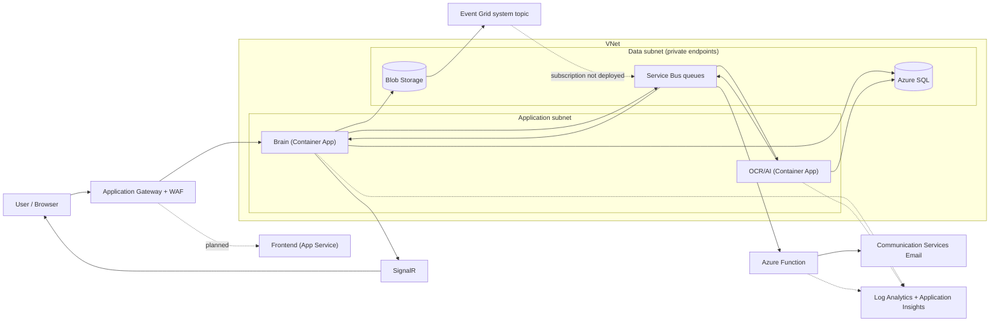
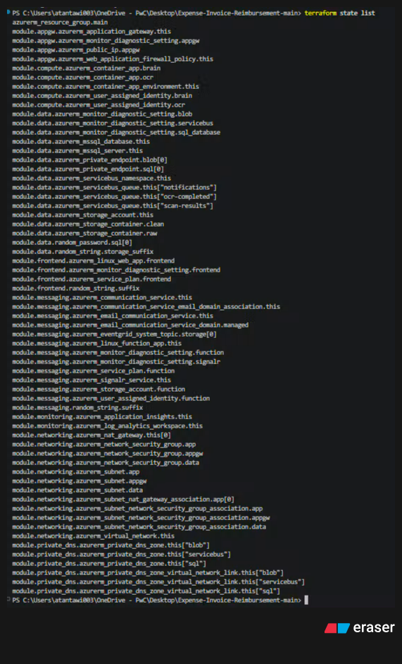
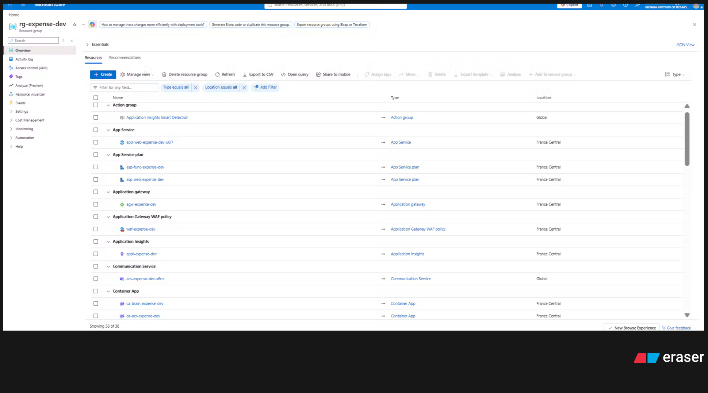
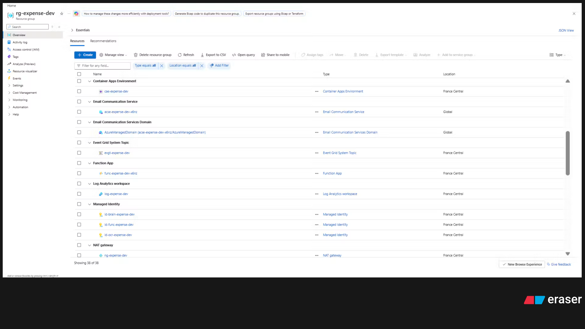
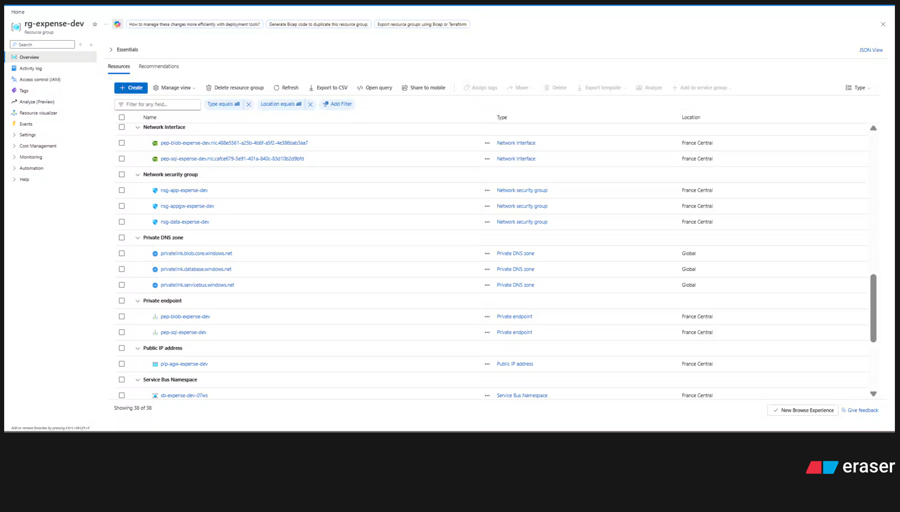
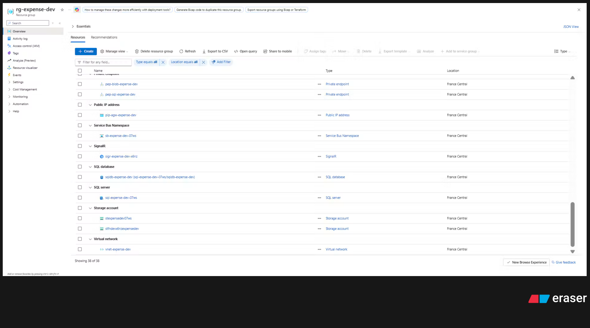
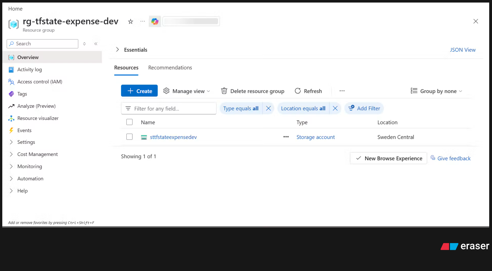

# Expense & Invoice Reimbursement: Azure Infrastructure (Terraform)

Infrastructure as Code for **Expense & Invoice Reimbursement**, a 3-tier Azure environment that lets employees submit
reimbursement claims with receipts and invoices, and lets approvers review them through a queue-based workflow.

This repository provisions the **infrastructure only**. No application code is included: the Container Apps run a placeholder image and
the Function App is empty. The goal is the foundation of the project, deployed reproducibly with Terraform.

| | |
| --- | --- |
| Cloud | Microsoft Azure |
| Region | France Central (`francecentral`) |
| IaC | Terraform `>= 1.6`, `azurerm ~> 4.0` |
| Remote state | Azure Blob Storage (`sttfstateexpensedev`, Sweden Central) |
| Environment | `dev` |
| Deployed resources | 38 in `rg-expense-dev` |

---

## Table of contents

1. [Project summary and status](#1-project-summary-and-status)
2. [Architecture](#2-architecture)
3. [Repository structure](#3-repository-structure)
4. [Deployment prerequisites](#4-deployment-prerequisites)
5. [Terraform execution steps](#5-terraform-execution-steps)
6. [Variables](#6-variables)
7. [Modules](#7-modules)
8. [Remote state configuration](#8-remote-state-configuration)
9. [Git and Merge Request workflow](#9-git-and-merge-request-workflow)
10. [Deployment evidence](#10-deployment-evidence)
11. [What happened during implementation](#11-what-happened-during-implementation)
12. [Implemented vs. not implemented](#12-implemented-vs-not-implemented)
13. [Security notes](#13-security-notes)
14. [Cleanup](#14-cleanup)

---

## 1. Project summary and status

The environment was built on a corporate subscription with restrictions: resources can be created, but **role assignments (RBAC)
cannot**, Entra ID cannot be configured, and some regions and resource providers are limited. The code was designed around these limits
by putting risky or permission-dependent parts behind toggles and documenting them instead of hardcoding workarounds.

**Deployed and verified (38 resources):** networking, private DNS, monitoring, data tier (Storage, SQL, Service Bus, private endpoints),
compute (Container Apps), Application Gateway with WAF, frontend (App Service), and messaging (SignalR, Email, Function, Event Grid topic).

**Present in code but not deployed:** Microsoft Defender malware scanning (`modules/defender`), role assignments (`modules/rbac`),
the Event Grid subscription, the Service Bus private endpoint, and the NAT Gateway public IP. See [section 12](#12-implemented-vs-not-implemented).

---

## 2. Architecture

### 2.1 Components

| Tier / area | Components |
| --- | --- |
| Entry | Application Gateway (WAF_v2) with a WAF policy and public IP |
| Presentation | Frontend on Azure App Service (Linux Web App) |
| Application | Container Apps environment with **Brain** (core API) and **OCR/AI** (queue worker) |
| Data | Storage Account (raw and clean files), Azure SQL Database (claims, OCR results, audit history), Service Bus queues |
| Messaging and notifications | SignalR (real-time status), Azure Function (notification processor), Azure Communication Services Email |
| Security | Managed identities (Brain, OCR, Function), NSGs, private endpoints, private DNS, WAF, NAT Gateway |
| Monitoring | Log Analytics Workspace, Application Insights, diagnostic settings on each service |

### 2.2 Network design

One VNet (`vnet-expense-dev`, `10.10.0.0/16`) with one subnet per tier:

| Subnet | CIDR | Purpose | Inbound rule (NSG) |
| --- | --- | --- | --- |
| `snet-appgw` | `10.10.0.0/24` | Application Gateway | Internet 80/443, GatewayManager, Azure Load Balancer |
| `snet-app` | `10.10.2.0/23` | Container Apps environment (delegated to `Microsoft.App/environments`), NAT Gateway | Only from the App Gateway subnet, plus intra-subnet and load balancer probes; everything else denied |
| `snet-data` | `10.10.4.0/24` | Private endpoints | Only from the application subnet (1433, 443, 5671); everything else denied |

SQL Database and Blob Storage are reached **only through private endpoints**, resolved by private DNS zones
(`privatelink.database.windows.net`, `privatelink.blob.core.windows.net`, `privatelink.servicebus.windows.net`) linked to the VNet.
The Container Apps environment uses an internal load balancer, so it is not reachable from the internet.

### 2.3 Diagram



Dotted lines show links that are designed but not active in the deployed environment.

### 2.4 Claim processing flow

1. The employee submits a claim. The **Brain** saves it to SQL and uploads the raw file to Blob Storage (`raw-uploads`).
2. A malware scan result is delivered through the Event Grid system topic to the Service Bus queue `scan-results`.
3. The **OCR** app reads the message, reads the clean file, extracts vendor, date, amount, currency and tax, and saves them to SQL.
4. The OCR app posts to the `ocr-completed` queue; the Brain moves the claim **Submitted → Under Review**.
5. The approver approves or rejects, then marks the claim **Reimbursed**. Every change is stored in the audit history table.
6. On each status change the Brain pushes a `StatusChanged` event through **SignalR** to the user's browser.
7. The Brain posts to the `notifications` queue; the **Function** is triggered and sends the email through **Communication Services Email**.
8. All services send logs and metrics to **Log Analytics**; application telemetry goes to **Application Insights**.

### 2.5 Mapping: architecture components to Terraform resources

| Architecture component | Terraform resource(s) | Module |
| --- | --- | --- |
| VNet + subnets | `azurerm_virtual_network`, `azurerm_subnet` | `networking` |
| Network isolation | `azurerm_network_security_group` and associations | `networking` |
| NAT Gateway | `azurerm_nat_gateway`, `azurerm_subnet_nat_gateway_association` | `networking` |
| Private DNS | `azurerm_private_dns_zone`, `azurerm_private_dns_zone_virtual_network_link` | `private_dns` |
| Log Analytics, Application Insights | `azurerm_log_analytics_workspace`, `azurerm_application_insights` | `monitoring` |
| Storage Account (raw and clean files) | `azurerm_storage_account`, `azurerm_storage_container` | `data` |
| Azure SQL | `azurerm_mssql_server`, `azurerm_mssql_database`, `random_password` | `data` |
| Service Bus queues | `azurerm_servicebus_namespace`, `azurerm_servicebus_queue` | `data` |
| Private endpoints | `azurerm_private_endpoint` (SQL, Blob) | `data` |
| Managed identities | `azurerm_user_assigned_identity` (Brain, OCR, Function) | `compute`, `messaging` |
| Brain, OCR | `azurerm_container_app_environment`, `azurerm_container_app` | `compute` |
| Application Gateway + WAF | `azurerm_application_gateway`, `azurerm_web_application_firewall_policy`, `azurerm_public_ip` | `appgw` |
| Frontend | `azurerm_service_plan`, `azurerm_linux_web_app` | `frontend` |
| SignalR | `azurerm_signalr_service` | `messaging` |
| Email | `azurerm_email_communication_service`, `azurerm_email_communication_service_domain`, `azurerm_communication_service`, domain association | `messaging` |
| Azure Function | `azurerm_linux_function_app`, `azurerm_service_plan`, `azurerm_storage_account` | `messaging` |
| Event Grid | `azurerm_eventgrid_system_topic` (subscription is toggled off) | `messaging` |
| Malware scanning | `azurerm_security_center_subscription_pricing` | `defender` (not deployed) |
| Role assignments | `azurerm_role_assignment` | `rbac` (not deployed) |
| Diagnostics | `azurerm_monitor_diagnostic_setting` | `data`, `messaging`, `frontend`, `appgw` |
| Public DNS zone, Entra ID | not implemented | logical flow only |

### 2.6 Dependency order

`resource group` → `networking`, `monitoring` → `private_dns` → `data` → `compute` → `appgw`, `frontend`, `messaging`

### 2.7 Assumptions

- The public DNS zone and custom domain are shown only in the logical flow and are not deployed.
- Entra ID (`.pwc.com` restriction, user and admin roles) is configured outside Terraform because Entra permissions are not available.
- The DNS Private Resolver is not deployed. Azure-provided DNS resolves the linked private DNS zones inside the VNet.
- Role assignments cannot be created with the available permissions, so they live in a separate module that is not instantiated.
- Service Bus uses the **Standard** SKU. Private endpoints for Service Bus need **Premium**, which is expensive, so that endpoint is off.
- The Event Grid topic uses `BlobCreated` events as a stand-in for Defender scan results.
- Container Apps and the Function App are placeholders because application code is out of scope.
- The Application Gateway listens on HTTP only because no certificate or domain exists.

---

## 3. Repository structure

```
.
├── main.tf                  # Root: resource group and module wiring
├── providers.tf             # Terraform and provider versions
├── backend.tf               # Remote state (azurerm backend, partial config)
├── variables.tf             # Input variables with validation
├── outputs.tf               # Outputs
├── .gitignore               # Excludes state, plans and *.tfvars
├── environments/
│   ├── dev.tfvars           # Local environment values (git-ignored)
│   ├── dev.tfvars.example   # Template with placeholder values (committed)
│   └── dev.backend.hcl      # Backend settings (no secrets)
├── modules/
│   ├── networking/       # VNet, subnets, NSGs, NAT Gateway
│   ├── private_dns/      # Private DNS zones and VNet links
│   ├── monitoring/       # Log Analytics, Application Insights
│   ├── data/             # Storage, SQL, Service Bus, private endpoints
│   ├── compute/          # Container Apps environment, Brain, OCR, identities
│   ├── appgw/            # Application Gateway, WAF, public IP
│   ├── frontend/         # App Service plan and Linux Web App
│   ├── messaging/        # SignalR, Email, Function, Event Grid topic
│   ├── defender/         # Defender for Storage (present, not deployed)
│   └── rbac/             # Role assignments (present, not deployed)
└── docs/                 # Deployment evidence (screenshots)
```

Resource names follow `<type>-<project>-<environment>[-<purpose>]`, for example `vnet-expense-dev`, `agw-expense-dev`, `ca-brain-expense-dev`.
Globally unique resources (Storage, SQL, Service Bus, Function, SignalR, Email) get a short random suffix.

---

## 4. Deployment prerequisites

| Prerequisite | Details |
| --- | --- |
| Tools | Terraform `>= 1.6`, Azure CLI |
| Azure access | Permission to create resources in the target subscription (Contributor on the resource group) |
| Remote state storage | Resource group `rg-tfstate-expense-dev` with storage account `sttfstateexpensedev` and container `tfstate`, created manually once |
| State authentication | `ARM_ACCESS_KEY` environment variable (storage account key). Entra authentication is not used because it needs a blob data role |
| Resource providers | Registered manually because the provider is set to `resource_provider_registrations = "none"` (see below) |
| Outside Terraform | Entra ID app registration, `.pwc.com` restriction, user and admin roles, SQL users for managed identities |

Register the providers that were required during deployment:

```bash
az provider register --namespace Microsoft.SignalRService
az provider register --namespace Microsoft.Communication
az provider register --namespace Microsoft.Web

# Wait until each shows "Registered"
az provider show -n Microsoft.SignalRService --query registrationState -o tsv
az provider show -n Microsoft.Communication  --query registrationState -o tsv
az provider show -n Microsoft.Web             --query registrationState -o tsv
```

---

## 5. Terraform execution steps

```powershell
az login
az account set --subscription <subscription-id>

# 1. Authenticate to the remote state (set in every new terminal session; never commit the key)
$env:ARM_ACCESS_KEY = az storage account keys list -g rg-tfstate-expense-dev -n sttfstateexpensedev --query "[0].value" -o tsv

# 2. Format and validate
terraform fmt -check -recursive
terraform init -backend-config=environments/dev.backend.hcl
terraform validate

# 3. Plan (attach the output to the Merge Request)
terraform plan -var-file=environments/dev.tfvars -out=tfplan

# 4. Apply (only from the merged commit on main_{name})
terraform apply tfplan
```

Local validation without Azure access: `terraform init -backend=false` followed by `terraform validate`.

Reading sensitive outputs:

```powershell
terraform output -raw sql_admin_password
```

---

## 6. Variables

Values are set in `environments/dev.tfvars`. This file is git-ignored; copy `environments/dev.tfvars.example` and fill in the real values.
No secrets belong in it. Network CIDRs, `project`, `environment`, `servicebus_sku` and `waf_mode` are validated at plan time.

| Variable | Description | Default |
| --- | --- | --- |
| `subscription_id` | Target Azure subscription | required |
| `project` | Short project name used in resource names | `expense` |
| `environment` | `dev`, `test` or `prod` | required |
| `location` | Azure region | required (`francecentral`) |
| `tags` | Tags applied to every resource | `{}` |
| `vnet_address_space` | VNet address space | required |
| `appgw_subnet_cidr` | Application Gateway subnet | required |
| `app_subnet_cidr` | Application subnet (`/23` or larger for Container Apps) | required |
| `data_subnet_cidr` | Data subnet for private endpoints | required |
| `enable_nat_gateway` | Create the NAT Gateway | `true` |
| `create_nat_public_ip` | Create and attach a public IP to the NAT Gateway | `false` |
| `log_retention_days` | Log Analytics retention | `30` |
| `enable_private_endpoints` | Private endpoints for SQL and Blob | `true` |
| `enable_servicebus_private_endpoint` | Service Bus private endpoint (requires Premium) | `false` |
| `servicebus_sku` | `Basic`, `Standard` or `Premium` | `Standard` |
| `storage_public_network_access_enabled` | Public access to the uploads storage account | `true` |
| `sql_admin_login` | SQL administrator login | `sqladmin_expense` |
| `sql_admin_password` | **Sensitive.** If unset, a random password is generated. Otherwise pass `TF_VAR_sql_admin_password` | `null` |
| `sql_database_sku` | SQL database SKU | `Basic` |
| `container_image` | Placeholder image for Brain and OCR | quickstart image |
| `waf_mode` | `Detection` or `Prevention` | `Prevention` |
| `app_service_plan_sku` | App Service plan SKU for the frontend | `B1` |
| `frontend_site_config` | Frontend web app settings: `always_on`, `minimum_tls_version`, `ftps_state`, `http2_enabled` | `{}` (secure defaults) |
| `signalr_sku_name` | `Free_F1` or `Standard_S1` | `Free_F1` |
| `email_data_location` | Communication Services data location | `Europe` |
| `function_plan_sku` | Function plan SKU | `Y1` |
| `enable_eventgrid_topic` | Create the Event Grid system topic | `true` |
| `enable_eventgrid_subscription` | Create the subscription to the `scan-results` queue (needs a role on the topic identity) | `false` |

### Outputs

`resource_group_name`, `vnet_id`, `subnet_ids`, `nat_gateway_public_ip`, `log_analytics_workspace_name`, `application_insights_id`,
`private_dns_zone_ids`, `storage_account_name`, `sql_server_fqdn`, `sql_admin_password` (sensitive), `servicebus_namespace_name`,
`servicebus_queue_ids`, `brain_fqdn`, `container_app_environment_static_ip`, `managed_identities`, `application_gateway_public_ip`,
`frontend_hostname`, `signalr_hostname`, `function_app_name`, `email_sender_domain`, `function_identity`, `eventgrid_system_topic_principal_id`.

### Module-level variables

| Module | Variable | Description | Default |
| --- | --- | --- | --- |
| `monitoring` | `log_analytics_sku` | Log Analytics workspace SKU | `PerGB2018` |
| `monitoring` | `application_insights_type` | Application Insights application type | `web` |
| `monitoring` | `retention_in_days` | Retention, validated between 30 and 730 | `30` |
| `frontend` | `site_config` | Web app site settings, validated for TLS version and FTPS state | secure defaults |
| `frontend` | `name_suffix` | Validated to 47 characters so the web app name stays within 60 characters | required |
| `networking` | `vnet_address_space`, `*_subnet_cidr` | Validated as IPv4 CIDRs (application subnet must be `/23` or larger) | required |

---

## 7. Modules

| Module | Responsibility | Key resources |
| --- | --- | --- |
| `networking` | Network isolation between tiers | VNet, 3 subnets, 3 NSGs, NAT Gateway |
| `private_dns` | Name resolution for private endpoints | 3 private DNS zones with VNet links |
| `monitoring` | Central logging and telemetry | Log Analytics workspace, Application Insights |
| `data` | Persistent storage and messaging | Storage account (`raw-uploads`, `clean-files`), SQL server and database, Service Bus with queues `scan-results`, `ocr-completed`, `notifications`, private endpoints, diagnostics |
| `compute` | Application tier | Managed identities, Container Apps environment (internal), Brain app, OCR app |
| `appgw` | Public entry point | Application Gateway WAF_v2, WAF policy (OWASP 3.2), public IP, diagnostics |
| `frontend` | User and admin portal hosting | App Service plan, Linux Web App, diagnostics |
| `messaging` | Real-time updates and notifications | SignalR, Email service and Azure-managed domain, Communication Service, Function App with identity, Event Grid system topic |
| `defender` | Malware scanning on uploads | Defender for Storage pricing plan (**not instantiated**) |
| `rbac` | Role assignments for managed identities | `azurerm_role_assignment` for Brain, OCR, Function and Event Grid (**not instantiated**) |

---

## 8. Remote state configuration

State is stored in Azure Blob Storage, configured in `backend.tf` (empty `azurerm` block) with values supplied at init time from
`environments/dev.backend.hcl`:

```hcl
resource_group_name  = "rg-tfstate-expense-dev"
storage_account_name = "sttfstateexpensedev"
container_name       = "tfstate"
key                  = "expense-reimbursement/dev.tfstate"
use_azuread_auth     = false
```

- **State locking:** Azure Blob leases lock the state automatically, so concurrent applies are blocked.
- **Authentication:** the storage account key through `ARM_ACCESS_KEY`.
- **Not committed:** `*.tfstate`, `.terraform/`, `errored.tfstate` and plan files must stay out of Git (`.gitignore`).
- **Sensitive data in state:** the generated SQL password is stored in the state, so access to the state storage account must be restricted.

If a lock is left behind after an interrupted run, unlock it with the ID shown in the error:

```powershell
terraform force-unlock <LOCK_ID>
```

---

## 9. Git and Merge Request workflow

1. Create a feature branch from `main_{name}`: `git checkout -b feature/<change>`.
2. Implement the change and run `terraform fmt`, `terraform validate` and `terraform plan`.
3. Push the branch and open a Merge Request targeting `main_{name}` with a description, the plan output and deployment notes.
4. Address review comments and pipeline failures, then obtain approval and merge.
5. Run `terraform apply` **only from the merged commit** on `main_{name}`.
6. Any later change goes through a new Merge Request.

Rules: no direct commits to `main_{name}`, no deployment from feature branches, no secrets or state in Git.

---

## 10. Deployment evidence

### Terraform state

`terraform state list` shows the resources managed by Terraform after the deployment.



### Resource group `rg-expense-dev` (38 resources)

Application Gateway, WAF policy, App Service and plans, Application Insights, Communication Service, Container Apps.



Container Apps environment, Email service and managed domain, Event Grid system topic, Function App, Log Analytics, managed identities, NAT gateway.



Network interfaces of the private endpoints, NSGs, private DNS zones, private endpoints, public IP, Service Bus namespace.



SignalR, SQL server and database, storage accounts, virtual network.



### Remote state storage account

Resource group `rg-tfstate-expense-dev` holding the state storage account (prerequisite, created manually).



### Resource inventory

| Resource | Name | Type |
| --- | --- | --- |
| Resource group | `rg-expense-dev` | Resource group |
| Virtual network | `vnet-expense-dev` | VNet |
| NSGs | `nsg-appgw-expense-dev`, `nsg-app-expense-dev`, `nsg-data-expense-dev` | Network security group |
| NAT Gateway | `ng-expense-dev` | NAT gateway |
| Private DNS | `privatelink.blob.core.windows.net`, `privatelink.database.windows.net`, `privatelink.servicebus.windows.net` | Private DNS zone |
| Log Analytics | `log-expense-dev` | Log Analytics workspace |
| Application Insights | `appi-expense-dev` | Application Insights |
| Storage (uploads) | `stexpensedev07ws` | Storage account |
| SQL | `sql-expense-dev-07ws`, `sqldb-expense-dev` | SQL server, database |
| Service Bus | `sb-expense-dev-07ws` | Namespace with 3 queues |
| Private endpoints | `pep-sql-expense-dev`, `pep-blob-expense-dev` | Private endpoint |
| Identities | `id-brain-expense-dev`, `id-ocr-expense-dev`, `id-func-expense-dev` | Managed identity |
| Container Apps | `cae-expense-dev`, `ca-brain-expense-dev`, `ca-ocr-expense-dev` | Environment, 2 apps |
| Application Gateway | `agw-expense-dev`, `waf-expense-dev`, `pip-agw-expense-dev` | Gateway, WAF policy, public IP |
| Frontend | `app-web-expense-dev-u6i7`, `asp-web-expense-dev` | Web App, plan |
| SignalR | `sigr-expense-dev-x6nz` | SignalR |
| Email | `acse-expense-dev-x6nz`, `AzureManagedDomain`, `acs-expense-dev-x6nz` | Email service, domain, Communication Service |
| Function | `func-expense-dev-x6nz`, `asp-func-expense-dev`, `stfndevx6nzexpensedev` | Function App, plan, storage |
| Event Grid | `evgt-expense-dev` | System topic |

### Validation commands

```powershell
terraform fmt -check -recursive
terraform validate
terraform plan -var-file=environments/dev.tfvars
```

---

## 11. What happened during implementation

The deployment was done in stages, and several real constraints shaped the final code.

**1. Static Web App could not be created.**
The Static Web App is only available in a small set of regions, and the subscription did not allow creating resources in any of them.
The frontend was therefore moved to an **Azure App Service (Linux Web App)** in France Central (`modules/frontend`). The Static Web App
code in `modules/appgw` was commented out, and the Application Gateway currently routes all traffic through a basic rule to the Brain
backend pool. Connecting the gateway to the App Service backend is a planned next step.

**2. Resource providers were not registered.**
The provider is configured with `resource_provider_registrations = "none"`, so Terraform does not register namespaces. SignalR and Email
failed with `MissingSubscriptionRegistration` for `Microsoft.SignalRService` and `Microsoft.Communication`. Both were registered manually
(and `Microsoft.Web` for the App Service and Function), then the apply was repeated. This is now listed as a prerequisite.

**3. The Event Grid subscription failed with a managed identity authorization error.**
The subscription delivers to the Service Bus queue with the system topic's managed identity, which needs the
*Azure Service Bus Data Sender* role. Role assignments are not possible with the available permissions, so the Event Grid resource was
split into two toggles: `enable_eventgrid_topic = true` (deployed) and `enable_eventgrid_subscription = false` (waiting for the role).

**4. The state was interrupted during an apply.**
A network interruption prevented Terraform from writing to the remote state, which produced `errored.tfstate` and a stale state lock.
The lock was released with `terraform force-unlock` and the state was restored and verified with `terraform state list`.
Lesson learned: never run `terraform apply` again before the state is recovered, and set `ARM_ACCESS_KEY` in every new terminal.

**5. NAT Gateway public IP.**
The NAT Gateway resource and its subnet association are deployed, but the public IP is controlled by `create_nat_public_ip` (currently `false`).

**6. Application Gateway and Brain communication.**
TLS ends at the gateway. The gateway reaches the internal Container Apps environment over HTTP, using the Brain FQDN as the host header,
because the internal environment's default certificate is not trusted by the gateway.

---

## 12. Implemented vs. not implemented

| Area | Status | Notes |
| --- | --- | --- |
| Networking, NSGs, NAT Gateway resource | Deployed | NAT public IP not created (`create_nat_public_ip = false`) |
| Private DNS and private endpoints (SQL, Blob) | Deployed | |
| Monitoring and diagnostics | Deployed | |
| Storage, SQL, Service Bus and queues | Deployed | Service Bus is Standard |
| Container Apps (Brain, OCR) | Deployed | Placeholder image |
| Application Gateway + WAF | Deployed | HTTP only; routes to Brain only |
| Frontend (App Service) | Deployed | Not yet connected to the gateway |
| SignalR, Email, Function | Deployed | Function is empty |
| Event Grid system topic | Deployed | |
| **Event Grid subscription** | Not deployed | Needs *Service Bus Data Sender* on the topic identity |
| **Service Bus private endpoint** | Not deployed | Needs Premium SKU |
| **Microsoft Defender malware scanning** | Code present, not deployed | `modules/defender`; subscription-wide setting that needs elevated rights; not instantiated in the root `main.tf` |
| **RBAC role assignments** | Code present, not deployed | `modules/rbac`; the deploying account cannot assign roles; not instantiated in the root `main.tf` |
| Static Web App | Replaced | Region restrictions; App Service used instead |
| Public DNS zone, custom domain, HTTPS | Not implemented | Logical flow only |
| Entra ID, `.pwc.com` restriction, user/admin roles | Not implemented | Outside Terraform |
| SQL users for managed identities | Not implemented | Needs T-SQL (`CREATE USER ... FROM EXTERNAL PROVIDER`) |

### Role assignments to apply later (administrator)

| Identity | Role | Scope |
| --- | --- | --- |
| Brain | Storage Blob Data Contributor | Storage account |
| Brain | Azure Service Bus Data Sender and Receiver | Service Bus namespace |
| Brain | SignalR App Server | SignalR |
| OCR | Storage Blob Data Contributor | Storage account |
| OCR | Azure Service Bus Data Sender and Receiver | Service Bus namespace |
| Function | Azure Service Bus Data Receiver | Service Bus namespace |
| Event Grid system topic | Azure Service Bus Data Sender | Service Bus namespace |

To activate them later, instantiate the `rbac` module in the root `main.tf` and pass the identities and scopes from `compute`, `messaging`
and `data`. To activate malware scanning, instantiate the `defender` module with `enable_malware_scanning = true`.

---

## 13. Security notes

- No credentials are stored in the repository. The SQL password is generated by Terraform (or passed through `TF_VAR_sql_admin_password`) and kept only in the remote state.
- Service Bus has local authentication disabled, so only managed identities can connect.
- SQL and Blob are reachable only through private endpoints; SQL public access is disabled while private endpoints are enabled.
- The Application Gateway with WAF (OWASP 3.2, Prevention mode) is the single public entry point to the application tier.
- NSGs allow only appgw → app → data traffic.
- `ARM_ACCESS_KEY`, `*.tfstate`, `errored.tfstate` and secret `.tfvars` files must never be committed.
- Known gaps: HTTP only on the gateway, public default hostname on the App Service, storage public access still enabled, and the Function and App Service run outside the VNet.

---

## 14. Cleanup

```powershell
terraform destroy -var-file=environments/dev.tfvars
```

After the destroy completes, remove the state prerequisite if it is no longer needed:

```bash
az group delete --name rg-tfstate-expense-dev
```

Cost note: the Application Gateway (WAF_v2) and the NAT Gateway are the most expensive resources in this environment. Destroy the
environment after collecting evidence.